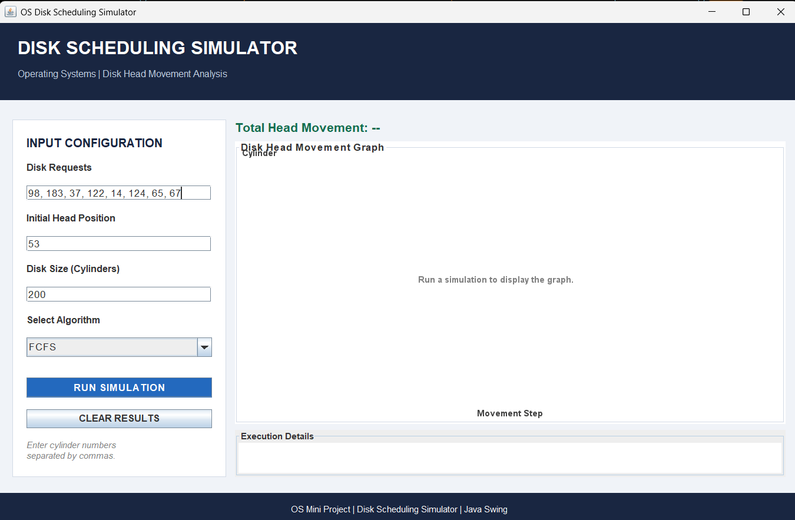
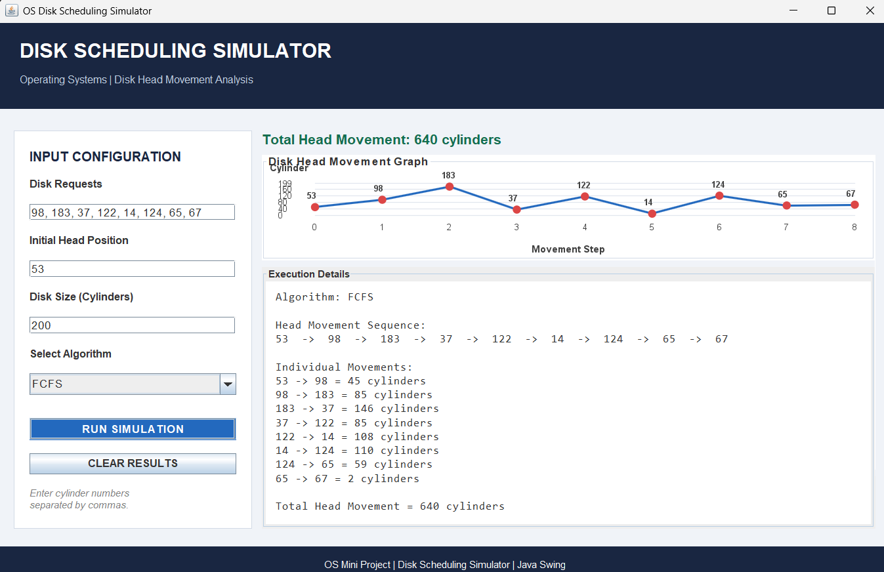
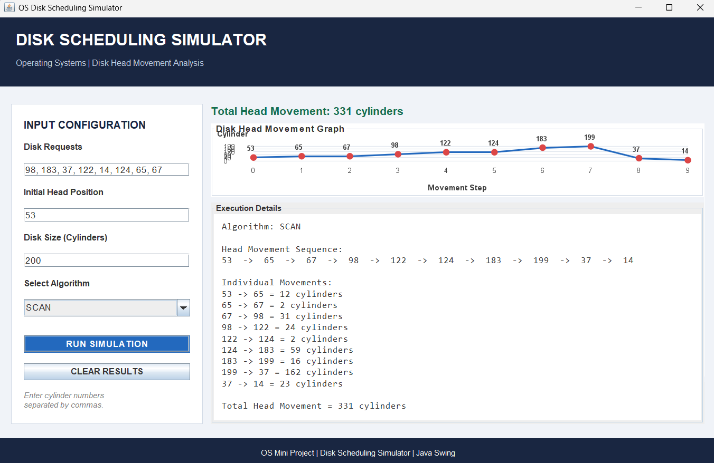
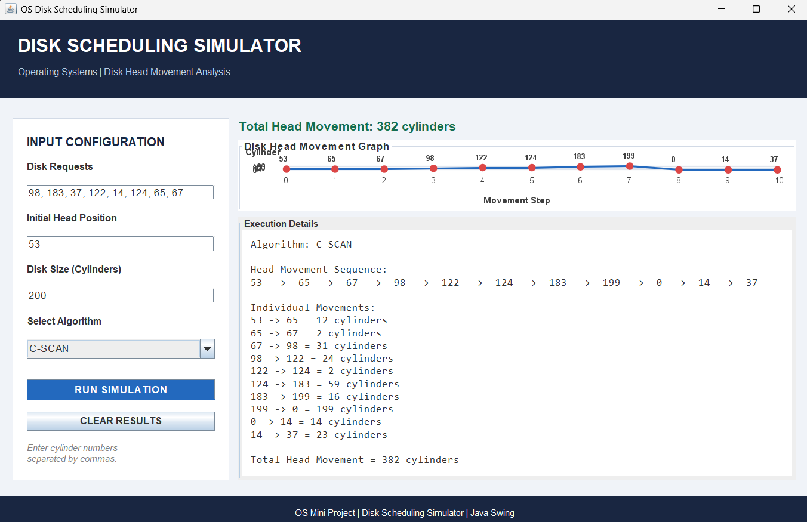

# Disk Scheduling Simulator

An OS mini project simulating disk head scheduling algorithms with a Java Swing GUI.

## Algorithms Implemented
- FCFS (First Come First Served)
- SCAN (Elevator Algorithm)
- C-SCAN (Circular SCAN)

## Features
- Visual graph of disk head movement
- Step-by-step execution details
- Total head movement calculation
- Input validation and error handling

## How to Run

**Requirements:** Java JDK installed

```bash
javac DiskSchedulingSimulator.java
java DiskSchedulingSimulator
```

## Screenshots






## Tech Stack
- Java
- Java Swing (GUI)
- AWT (Graphics)